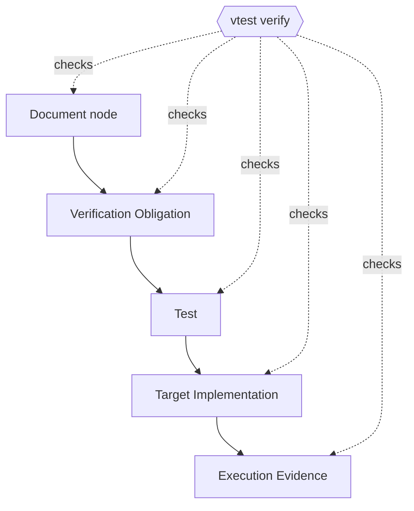

<div align="center">

# SpecTracer

### Know not only that your tests pass — know what they prove.

**Fail-closed verification and traceability for AI-parallel software development.**


[](https://github.com/YmSaki/SpecTracer/actions/workflows/ci.yml)


`SpecTracer` connects specifications, verification obligations, tests, source code, audits, and execution evidence into one traceable verification graph.

SpecTracer's verification model is language- and test-runner-agnostic by design.
The current implementation ships one production adapter, Rust/Cargo
(`vtest-adapter-rust`), behind a language-neutral adapter API; adapters for
TypeScript, JavaScript, Go, C#, and other ecosystems are future work.

**The current CLI binary is `vtest`.**

</div>

---

## Why SpecTracer?

A green test suite answers one question:

> **Did these tests pass?**

It does **not** automatically answer:

- Did every requirement get a test?
- Does the test verify the behavior the specification actually asks for?
- Does the test call the implementation it claims to test?
- Does the target result actually reach an assertion?
- Is the evidence still valid after the code changed?
- Was the declared target executed at all?
- Is an old audit being mistaken for proof about the current revision?

Those gaps get more dangerous when multiple coding agents work in parallel. Code can move faster than the evidence that is supposed to justify it.

SpecTracer is built for that gap.



**If a required link is missing, stale, ambiguous, mismatched, or not checked, SpecTracer returns a non-OK result.**

---

## The idea in one sentence

> **Turn “the tests are green” into “this specification is backed by current, inspectable evidence.”**

SpecTracer is a verification layer around your tests and development process; keep your testing framework for running tests.

| Question | Test runner | Coverage tool | SpecTracer |
|---|:---:|:---:|:---:|
| Did the test process pass? | ✓ | — | ✓ (Evidence) |
| What specification node is this test supposed to prove? | — | — | ✓ |
| Did the declared target get bound and measured? | — | partial | ✓ |
| Does the test carry an oracle (assertion) at all? | — | — | ✓ |
| Is this Evidence still current after edits? | — | — | ✓ |
| Can incomplete verification silently become `OK`? | Possible | Possible | **No** (fail-closed) |

See [Project status](#project-status) for what is implemented today and what is
still tracked as open work.

---

## Language support

SpecTracer separates its language-independent verification contract from the
ecosystem-specific machinery used to discover and execute tests.

- **Language-independent contract:** specifications, requirements, Verification
  Obligations, Test identity and intent, approvals, audits, Evidence, content
  hashes, fail-closed states, aggregation, and reporting.
- **Current adapter:** `vtest-adapter-rust` provides Rust `#[test]` discovery,
  Rust symbol resolution (canonical Locators), Cargo test execution, and
  `cargo-llvm-cov` target measurement. `vtest-adapter-synthetic` is a test-only
  adapter that proves the core does not depend on Rust.
- **Intended expansion:** TypeScript/JavaScript, Go, C#, and other languages and
  test runners through explicit adapters that declare their capabilities
  (source discovery, static analysis, test runner, coverage, ...). A missing
  capability yields `NO_EVIDENCE` with a `NOT_EXECUTED` / `NOT_CHECKED`
  diagnostic label, never `PASS`.

The adapter separation (v0.2) is in progress: the neutral
`ExecutionDescriptor`, config v2, the adapter registry, and the synthetic
adapter exist, while some boundaries (for example Structured Test Operations
still parsing Rust directly in `vtest-scan`) are tracked as open issues.

Framework-neutral discovery adapters for other languages are documented in
[`docs/adapters/`](docs/adapters/lexical.md). They trace `@vtest.` declarations
written in ordinary comments and leave execution and coverage `NO_EVIDENCE`.

Support is evidence-based: an ecosystem is supported only after its discovery,
execution, freshness, and target-measurement behavior has reproducible acceptance
coverage. Return `NOT_CHECKED` or `UNKNOWN` for unsupported or unavailable
analysis, because a promoted `PASS` would claim support that has no evidence; when
support is added, promote the result only through reproducible acceptance coverage.

---

## 60-second tour: current Rust adapter

This is the current procedure.

### 1. Build the CLI

```bash
cargo install --path crates/vtest-cli
vtest --help
```

### Install a prebuilt release

Version tags on `main` are built for Linux x86_64, macOS x86_64, and Windows
x86_64 by GitHub Actions. Each release contains a compressed archive and a
SHA-256 checksum file. Download the matching asset from the
[GitHub Releases page](https://github.com/YmSaki/SpecTracer/releases/latest),
extract `vtest` (or `vtest.exe` on Windows), and put it on your `PATH`.

Release tags must use the `vMAJOR.MINOR.PATCH` form, optionally followed by an
ASCII SemVer pre-release identifier such as `-alpha.1`, and match the workspace
version in `Cargo.toml`; tags that are not reachable from `main` are rejected.

### 2. Initialize verification metadata

```bash
vtest init --name my-project
```

This creates the canonical `.verify/` layout.

### 3. Register a specification document

Specifications are registered as document node trees: one JSON file per
document, whose nodes carry stable IDs and `derives_from` links to upstream
nodes.

```bash
vtest doc add --id calculator --path docs/calculator.json
vtest doc list --tree
```

### 4. Declare a Verification Obligation (VO)

VOs are plain YAML records under `.verify/vo/`, one file per VO, deriving from
one or more document nodes:

```yaml
# .verify/vo/VO-CALC-001.yaml
id: VO-CALC-001
parent: null
derives_from:
  - doc: SPEC-001   # a node id from a registered document
claim: add(a, b) returns a + b
dimensions: []
coverage_policy: null
combinations: []
representative_cases: []
created: 2026-01-01T00:00:00Z
updated: 2026-01-01T00:00:00Z
```

A `vtest vo` command family is not provided yet; it is tracked as an open issue.

### 5. Bind a test to the obligation and its target

```rust
/// @vtest.id TEST-CALC-001
/// @vtest.covers VO-CALC-001
/// @vtest.target src/lib.rs::add
/// @vtest.intent verifies that add returns the arithmetic sum
#[test]
fn adds_two_numbers() {
    assert_eq!(add(2, 3), 5);
}
```

The annotation is not just documentation. It gives the test an identity, states what it claims to cover, identifies the intended source target, and records its human-readable intent.

### 6. Scan, run, and verify

```bash
vtest doctor          # config and adapter preconditions
vtest scan            # consistency diagnostics
vtest run --all       # execute Tests and record Evidence
vtest verify          # aggregate the four checks: OK / NG
```

For automation, every command accepts `--format json` and returns the same
`{ok, data, diagnostics}` envelope.

### 7. Approve

```bash
vtest approval create --subject-type vo --subject-id VO-CALC-001 \
  --state approved --approver-kind human --approver-id alice
vtest approval show --subject-type vo --subject-id VO-CALC-001
```

An approval is bound to the subject's content hash and its upstream
dependencies; editing either returns the effective state to `draft`.

---

## Fail-closed by design

SpecTracer treats “not proven” as different from “proven.”

`vtest verify` evaluates four checks: `chain_integrity`, `orphan_detection`,
`target_binding`, and `oracle_presence`. Each check result has one of five
states:

```text
PASS
FAIL
MISMATCH
NO_EVIDENCE
UNKNOWN
```

Diagnostic labels (`MISSING`, `NOT_EXECUTED`, `NOT_CHECKED`, `STALE`) explain
*why* a result is not `PASS`; they are listed side by side and never ranked.

For complete verification, **only `PASS` is OK**.

That means:

```text
old Evidence + changed source   -> NO_EVIDENCE (STALE)
no Evidence                     -> NO_EVIDENCE (NOT_EXECUTED)
missing adapter capability      -> NO_EVIDENCE (NOT_EXECUTED / NOT_CHECKED)
out-of-scope check              -> NO_EVIDENCE (NOT_CHECKED)
unresolvable target             -> MISMATCH (MISSING)
```

This is intentional. SpecTracer is designed to preserve uncertainty instead of laundering it into confidence.

---

## Traceability model

SpecTracer separates three kinds of truth:

1. **Declaration** — what the project says should be verified.
2. **Implementation** — the actual test and target code.
3. **Evidence** — what was audited, executed, and observed.

The system compares them and reports the difference, leaving both sides as written until a person or agent changes one.

```text
Document node (specification, design, ...)
    ↓  derives_from
Verification Obligation (VO)
    ↓  @vtest.covers
Test
    ↓  @vtest.target
Target implementation
    ↓
Execution Evidence
```

A mismatch is surfaced as a mismatch. Deciding whether the specification, test, or implementation should change remains a separate engineering decision.

---

## Canonical project data

SpecTracer keeps canonical records under `.verify/`:

```text
.verify/
├── config.yaml      # project configuration (version 2: adapters, gates, approval roles)
├── doc/             # registered document node trees, one JSON file per document
├── vo/              # Verification Obligations, one YAML file per VO
├── rel/             # explicit relations
├── forms/           # structured operation schemas
├── decisions/       # judgment records (reserved; not implemented yet)
├── approvals/       # append-only approval records
├── evidence/        # append-only execution Evidence
└── cache/           # derived data; safe to rebuild
```

The design keeps independent entities in independent files instead of one giant shared registry file, which makes the format friendlier to parallel branches and parallel agents.

Derived indexes and graphs are rebuilt from canonical data rather than becoming a second source of truth.

---

## Built for AI-parallel development

SpecTracer assumes a development environment where multiple agents may independently:

- implement different slices,
- write or edit tests,
- review changes,
- audit semantics,
- and merge work concurrently.

The verification layer therefore favors:

- **stable IDs** over positional assumptions,
- **content hashes** over “this passed sometime before,”
- **append-only evidence** over mutable conclusions,
- **structured operations** over unconstrained metadata editing,
- **machine-readable JSON** for agent and CI integration,
- **conservative UNKNOWN** over unjustified certainty.

The MCP stdio server (`vtest-mcp`) exposes the same core operations to AI agents instead of creating a second behavior model: each tool calls the same shared operation as the CLI and returns the same envelope. It currently advertises nine tools: `scan`, `run_tests`, `verify`, `approval_create`, `approval_withdraw`, `approval_get`, `doc_upsert`, `doc_list`, and `doc_get`. The remaining tools in the specification (for example `form_get`, `test_create`, and `report`) are not provided yet. Launching the server through a `vtest mcp` subcommand is tracked as an open issue; today `vtest-mcp` is a library crate without its own binary.

---

## Project status

> **Status below means evidence, not code presence.**

The canonical model was redefined in the v0.1 canonical specification
(`docs/canonical/specification.json`): four checks and five states replace the
earlier eleven-item surface. The M1–M9 rows in
[`tests/ACCEPTANCE.md`](tests/ACCEPTANCE.md) record that retired surface; their
`m1_acceptance.rs` … `m9_acceptance.rs` suites are no longer built
(`autotests = false`) and are not evidence for the current model.

Current state:

| Area | State |
|---|---|
| `init`, `scan`, `doctor`, `run`, `verify`, `approval`, `doc` CLI | Implemented; acceptance tests under `crates/vtest-cli/tests/` |
| Four checks / five states / fail-closed aggregation | Implemented (`vtest-verify`) |
| Phase gates (`verify --gate`) | Implemented; approval-role evaluation is open work |
| Adapter API, registry, Rust and synthetic adapters | Implemented; separation (v0.2) still in progress |
| MCP stdio server | Nine tools; launch subcommand and remaining tools are open work |
| `vo`, `audit`, `report`, judgment records | Not provided yet |

Work is tracked with GitHub
[milestones](https://github.com/YmSaki/SpecTracer/milestones) and
[issues](https://github.com/YmSaki/SpecTracer/issues).

---

## Where SpecTracer is heading

Next steps, in the order the open issues track them:

1. finish the v0.2 adapter separation and its acceptance matrix;
2. bring the CLI and MCP surfaces to the canonical command and tool lists
   (`vo`, `audit`, `report`, `form_get`, `test_create`, `vtest mcp`);
3. add judgment records and the semantic audit flow; and
4. publish the first tagged release with documentation that matches it.

The goal is to make the provenance of every green result inspectable, so a check turns green through evidence rather than assumption.

---

## A tool should be able to say “I don't know”

One of SpecTracer's core design rules is that deterministic analysis states only what it can prove and returns `UNKNOWN` beyond that.

For example, if a test calls into code outside the deterministic analysis boundary, the claim “The target definitely was not called” overclaims, so SpecTracer concludes:

> **`UNKNOWN` — the available deterministic evidence is insufficient.**

That distinction matters when verification results are consumed by autonomous agents.

---

## CI and agent-friendly interfaces

The CLI supports human-readable text and JSON output:

```bash
vtest scan
vtest --format json scan
```

Exit codes are designed for automation:

| Code | Meaning |
|---:|---|
| `0` | requested operation/scope is OK |
| `1` | verification NG |
| `2` | usage/input error |
| `3` | internal error |

MCP tool results use the same envelope as the CLI JSON output; a tool error sets `isError` and carries the diagnostic `code`.

---

## Project documents

- [Architecture](ARCHITECTURE.md) — crate boundaries, canonical data, and adapter seams.
- [Development guide](DEVELOPMENT.md) — local setup, Git Flow, and release preparation.
- [Testing guide](TESTING.md) — required checks and acceptance evidence.
- [Roadmap](ROADMAP.md) — completed milestones and planned language adapters.
- [Contributing guide](CONTRIBUTING.md) — branch, pull request, and review expectations.
- [Changelog](CHANGELOG.md) — user-visible changes.
- [Security policy](SECURITY.md) and [Code of Conduct](CODE_OF_CONDUCT.md).
- [License](LICENSE) — MIT terms for using and redistributing SpecTracer.

---

## Where SpecTracer fits

SpecTracer works with the tools you already use:

- your language test runners such as `cargo test`, `go test`, `dotnet test`, or JavaScript/TypeScript test runners keep deciding pass and fail, and SpecTracer consumes their results as evidence,
- your code coverage tooling keeps measuring, and SpecTracer uses the measurement as target-execution evidence,
- semantic judgment comes from an external discoverer (an agent or a person), and SpecTracer records it bound to the current subject,
- a mismatch between layers is reported as `MISMATCH` pointing upstream, and a person or agent fixes the declaration,
- and every `PASS` carries evidence you can trace.

It is infrastructure for making claims about software **explicit, bounded, and auditable**.

---

## Repository layout

```text
crates/
├── vtest-model              # shared entities, hashes, diagnostics, states
├── vtest-store              # canonical record persistence
├── vtest-adapter-api        # adapter traits, capabilities, registry
├── vtest-adapter-rust       # Rust/Cargo adapter
├── vtest-adapter-synthetic  # test-only adapter proving language neutrality
├── vtest-scan               # scan orchestration and structured test operations
├── vtest-exec               # test execution and Evidence
├── vtest-verify             # four checks and fail-closed aggregation
├── vtest-cli                # CLI and shared operation layer
└── vtest-mcp                # MCP stdio server

docs/              # requirements, specifications, detailed design
.verify/           # dogfooded verification metadata
tests/             # fixtures and acceptance ledger
```

SpecTracer dogfoods its own verification model as the implementation grows.

---

## Contributing

Contributions are welcome, especially around:

- adversarial fixtures that expose false confidence,
- conservative static analysis,
- evidence freshness and reproducibility,
- semantic-audit protocols for coding agents,
- CI ergonomics,
- and MCP integration.

A useful contribution makes the verification contract stronger. When a change increases `PASS` results, show the evidence that justifies each one, because more `PASS` without stronger evidence reintroduces the false green this tool exists to stop.

Before declaring a milestone complete, add reproducible evidence to [`tests/ACCEPTANCE.md`](tests/ACCEPTANCE.md).

---

## Why the name “SpecTracer”?

Because the core question is not only:

> “Did the test run?”

It is:

> **“Can I trace this result all the way back to the specification it is supposed to justify?”**

---

## License

MIT.

---

<div align="center">

### Building software with coding agents?

If you want **evidence instead of vibes**, star the repository and follow the project as the verification chain grows from static audit to end-to-end execution evidence.

</div>
