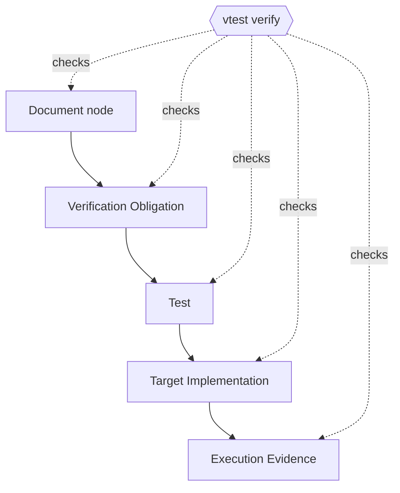

<div align="center">

# SpecTracer

### Know not only that your tests pass — know what they prove.

**Fail-closed verification and traceability for AI-parallel software development.**


[](https://github.com/YmSaki/SpecTracer/actions/workflows/ci.yml)


`SpecTracer` connects specifications, verification obligations, tests, source code, audits, and execution evidence into one traceable verification graph.

SpecTracer's verification model is language- and test-runner-agnostic by design.
The current implementation ships Rust/Cargo (`rust-cargo` in
`vtest-adapter-rust`) as its officially supported adapter, behind a
language-neutral adapter API. `rust-cargo` and `go` support the full
`scan` → `run` → `verify` path to `PASS`.
The Go adapter (`go` in `vtest-adapter-go`) is in the canonical v0.1 production
scope but still a preview: it discovers Tests by shape, runs them with
`go test`, measures with `go test`'s coverage whether a Test ran the targets it
declares (`target_binding` can be `PASS`), and reads the Test's text to find a
check that the target's result decides (`oracle_presence` can be `PASS`; anything
it cannot tell is `UNKNOWN`). A Go Test is `PASS` as a whole only when both are.
Ten experimental discovery-only adapters (`vtest-adapter-lexical`: C, C++, C#,
Java, JavaScript/TypeScript, Kotlin, PHP, Python, Ruby, and Swift) trace
`@vtest.` declarations without running tests; test runners and coverage for
those languages are not implemented yet.

**The current CLI binary is `vtest`.**

</div>

---

## Why SpecTracer?

A green test suite answers one question:

> **Did these tests pass?**

It does **not** automatically answer:

- Did every requirement get a test?
- Does the test verify the behavior the specification actually asks for?
- Does the test call the implementation it claims to test?
- Does the target result actually reach an assertion?
- Is the evidence still valid after the code changed?
- Was the declared target executed at all?
- Is an old audit being mistaken for proof about the current revision?

Those gaps get more dangerous when multiple coding agents work in parallel. Code can move faster than the evidence that is supposed to justify it.

SpecTracer is built for that gap.



**If a required link is missing, stale, ambiguous, mismatched, or not checked, SpecTracer returns a non-OK result.**

---

## The idea in one sentence

> **Turn “the tests are green” into “this specification is backed by current, inspectable evidence.”**

SpecTracer is a verification layer around your tests and development process; keep your testing framework for running tests.

| Question | Test runner | Coverage tool | SpecTracer |
|---|:---:|:---:|:---:|
| Did the test process pass? | ✓ | — | ✓ (Evidence) |
| What specification node is this test supposed to prove? | — | — | ✓ |
| Did the declared target get bound and measured? | — | partial | ✓ |
| Does the test carry an oracle (assertion) at all? | — | — | ✓ |
| Is this Evidence still current after edits? | — | — | ✓ |
| Can incomplete verification silently become `OK`? | Possible | Possible | **No** (fail-closed) |

See [Project status](#project-status) for what is implemented today and what is
still tracked as open work.

---

## Language support

SpecTracer separates its language-independent verification contract from the
ecosystem-specific machinery used to discover and execute tests.

- **Language-independent contract:** specifications, requirements, Verification
  Obligations, Test identity and intent, approvals, audits, Evidence, content
  hashes, fail-closed states, aggregation, and reporting.
- **Production adapter (`rust-cargo`):** `vtest-adapter-rust` provides Rust
  `#[test]` discovery, Rust symbol resolution (canonical Locators), static
  oracle analysis, Structured Test Operations (`test create` / `test edit`),
  Cargo test execution, and `cargo-llvm-cov` target measurement. `rust-cargo` is
  the only adapter with the full `scan` → `run` → `verify` path that can reach
  `PASS`. `vtest run` on Rust needs `cargo-llvm-cov` and the
  `llvm-tools-preview` rustup component to measure the declared targets;
  `vtest run --fast` runs `cargo test` alone and records no target coverage, so
  `target_binding` stays `NO_EVIDENCE`.
  `vtest-adapter-synthetic` is a test-only adapter that proves the core does not
  depend on Rust.
- **Go adapter (`go`, preview):** `vtest-adapter-go` is in the canonical v0.1
  production scope. Its discovery is delegated to the lexical `go` module.
  `vtest scan` finds a Test by shape: a top-level, receiverless `Test*` function
  in a `_test.go` file. A Test function without a `@vtest.` declaration gives
  `W-SCAN-101` and `chain_integrity` is `MISMATCH`; a `@vtest.` declaration on a
  method gives `W-SCAN-105`. `vtest run` runs `go test -count=1 -json` and
  records `PASS` / `FAIL` Evidence bound to the Execution State. It needs the
  `go` toolchain and a `go.mod`; a Test in no Go module gets `W-EXEC-102` and no
  Evidence. A run without `--fast` measures coverage (`go-cover`) for
  `target_binding`, and `vtest verify` reads the text of the Test, with a Go reader
  of its own that starts no process, for `oracle_presence`: it is `PASS` only when
  a value derived from the call of a declared target decides a failure report,
  `panic` or listed assertion call, and `UNKNOWN` where the audit cannot tell (a
  check in a helper, a goroutine or a `defer`, a result that is passed on or
  changed). The static reach of a target (DA-002) is not provided, so
  `target_binding` rests on coverage alone. See
  [`docs/adapters/go.md`](docs/adapters/go.md) for what the audit counts and for
  its known false `PASS` shapes.
- **Experimental discovery adapters (`vtest-adapter-lexical`):** Ten
  discovery-only adapters are registered in `crates/vtest-ops/src/registry.rs`:
  `c` (C), `cpp` (C++), `csharp` (C#), `java` (Java), `javascript`
  (JavaScript and TypeScript), `kotlin` (Kotlin), `php` (PHP), `python`
  (Python), `ruby` (Ruby), and `swift` (Swift). Each declares only
  `source_discovery`. `vtest scan` reads their `@vtest.` declarations, and
  `vtest verify` evaluates `chain_integrity` and `orphan_detection`.
  `vtest run` rejects them with `E-ADAPTER-004`. A `vtest verify` run that
  completes always reports `Result: NG`, including when `--items` limits the
  run to `chain_integrity,orphan_detection`, because `target_binding` and
  `oracle_presence` remain `NO_EVIDENCE`. Its exit code is `1`, unless `--gate`
  names a gate that the result satisfies; the reported result is still `NG`. `vtest init` writes a configuration
  for `rust-cargo` only, so projects in Go or these ten languages are not scanned
  until `.verify/config.yaml` is edited (set `adapters[].id`, list paths in
  `adapters[].scan.include`, and set `adapters[].run.coverage` to `off`).
- **Intended expansion:** Adding test runners, coverage measurement, and static
  analysis for languages other than Rust through explicit adapters that declare
  their capabilities. A missing capability yields `NO_EVIDENCE` with
  `NOT_EXECUTED` or `NOT_CHECKED` diagnostic labels, never `PASS`.

The core adapter separation is in place (`ExecutionDescriptor`, config v2,
`AdapterRegistry`, `StructuredTestAdapter`, the `vtest-ops` composition root,
and `vtest-adapter-synthetic`). Remaining adapter-boundary items (such as
emitting `W-ADAPTER-101` on missing capabilities, per-adapter Form conflict
detection, and validating `adapters[].scan.assertion_macros`) are tracked as
open issues.

The ten framework-neutral discovery adapters are documented in
[`docs/adapters/`](docs/adapters/lexical.md). They trace `@vtest.` declarations
written in ordinary comments and leave execution, coverage, and static oracle
checks `NO_EVIDENCE`. The Go adapter is documented in
[`docs/adapters/go.md`](docs/adapters/go.md).

Support is evidence-based: an ecosystem is supported only after its discovery,
execution, freshness, and target-measurement behavior has reproducible acceptance
coverage. Return `NOT_CHECKED` or `UNKNOWN` for unsupported or unavailable
analysis, because a promoted `PASS` would claim support that has no evidence; when
support is added, promote the result only through reproducible acceptance coverage.

---

## 60-second tour: current Rust adapter

This is the current procedure. For Rust execution and coverage evidence,
`vtest run` needs `cargo-llvm-cov` and the `llvm-tools-preview` rustup
component (`vtest run --fast` does not, and records no target coverage):

```bash
rustup component add llvm-tools-preview
cargo install cargo-llvm-cov --locked
```

### 1. Build the CLI

```bash
cargo install --path crates/vtest-cli
vtest --help
```

### Install a prebuilt release

Version tags on `main` are built for Linux x86_64, macOS x86_64, and Windows
x86_64 by GitHub Actions. Each release contains a compressed archive and a
SHA-256 checksum file. The `v0.1.0-beta.1` release is a pre-release, so it does
not appear at `/releases/latest`; pick it from the
[GitHub Releases list](https://github.com/YmSaki/SpecTracer/releases), extract
`vtest` (or `vtest.exe` on Windows), and put it on your `PATH`.

Release tags must use the `vMAJOR.MINOR.PATCH` form, optionally followed by an
ASCII SemVer pre-release identifier such as `-beta.1`, and match the workspace
version in `Cargo.toml`; tags that are not reachable from `main` are rejected.

### 2. Initialize verification metadata

```bash
vtest init --name my-project
```

This creates the canonical `.verify/` layout with `.verify/config.yaml`
configured for `rust-cargo` only (for other languages, edit the adapter entry;
see the configuration example in
[`docs/adapters/lexical.md`](docs/adapters/lexical.md)).

### 3. Register a specification document

Specifications are registered as document node trees: one JSON file per
document, whose nodes carry stable IDs and `derives_from` links to upstream
nodes. `orphan_detection` passes when every non-`root` node has an upstream,
either through its own `derives_from` or through that of a node that contains
it. For example, `docs/calculator.json`:

```json
{
  "schema_version": "0.1",
  "root": [
    {
      "id": "ROOT-001",
      "statement": "Calculator operations must be accurate.",
      "source": { "doc": "docs/calculator.md", "heading": "Root", "lines": [1, 1] }
    }
  ],
  "request": [],
  "require": [],
  "spec": [
    {
      "id": "SPEC-S001",
      "title": "Arithmetic",
      "source": { "doc": "docs/calculator.md", "heading": "Arithmetic", "lines": [2, 3] },
      "derives_from": ["ROOT-001"],
      "items": [
        {
          "id": "SPEC-001",
          "statement": "add(a, b) returns a + b",
          "derives_from": ["ROOT-001"],
          "source": { "doc": "docs/calculator.md", "heading": "Arithmetic", "lines": [3, 3] }
        }
      ]
    }
  ],
  "detailed_spec": [],
  "basic_design": [],
  "design": []
}
```

```bash
vtest doc add --id calculator --path docs/calculator.json
vtest doc list --tree
```

`--tree` shows the chain of registered documents, not the nodes inside them:
each document ID is indented under the documents its nodes derive from. With
only `calculator` registered, the tree is the single entry `calculator`.

### 4. Declare a Verification Obligation (VO)

VOs are YAML records under `.verify/vo/`, one file per VO, deriving from one or
more document nodes:

```bash
vtest vo add --id VO-CALC-001 --derives-from SPEC-001 --claim "add(a, b) returns a + b"
vtest vo show VO-CALC-001
```

### 5. Bind a test to the obligation and its target

In `src/lib.rs`:

```rust
pub fn add(a: i32, b: i32) -> i32 {
    a + b
}

/// @vtest.id TEST-CALC-001
/// @vtest.covers VO-CALC-001
/// @vtest.target src/lib.rs::add
/// @vtest.intent verifies that add returns the arithmetic sum
#[test]
fn adds_two_numbers() {
    assert_eq!(add(2, 3), 5);
}
```

The annotation is not just documentation. It gives the test an identity, states what it claims to cover, identifies the intended source target, and records its human-readable intent.

### 6. Scan, run, and verify

In a new Cargo project without `Cargo.lock`, the first `vtest run` reports
`E-EXEC-004` and exits `1`, because Cargo creates `Cargo.lock` while the first
Test runs. That Test gets no Evidence and stays `NO_EVIDENCE (NOT_EXECUTED)`.
Tests that run after it still get Evidence, bound to the state with the new
`Cargo.lock`. Create `Cargo.lock` first with `cargo generate-lockfile`. Also ensure
the project has a git commit, because Evidence binds to git `HEAD` (without a
commit, `target_binding` stays `NO_EVIDENCE (STALE)`):

```bash
cargo generate-lockfile
git init                                  # if not already a git repository
git add . && git commit -m "initial spec and test"
vtest doctor          # config and adapter preconditions
vtest scan            # consistency diagnostics
vtest run --all       # execute Tests and record Evidence
vtest verify          # aggregate the four checks: OK / NG
```

For automation, these commands accept `--format json` and return the same
`{ok, data, diagnostics}` envelope.

Evidence is also bound to the Execution State at run time: the toolchain, the
adapter configuration that affects execution, and the input manifest. The
`rust-cargo` adapter records the `CARGO*` / `RUST*` environment variables that
affect the build (for example `CARGO_TARGET_DIR`) as part of that state, so if
`vtest run` and `vtest verify` see different values, `target_binding` becomes
`NO_EVIDENCE (STALE)`. This is the intended fail-closed behavior; run both
commands in the same environment.

### 7. Approve

```bash
vtest approval create --subject-type vo --subject-id VO-CALC-001 \
  --state approved --approver-kind human --approver-id alice
vtest approval show --subject-type vo --subject-id VO-CALC-001
```

(`vtest vo approve` is an alias for `vtest approval create --subject-type vo`.)
An approval is bound to the subject's content hash and its upstream
dependencies; editing either returns the effective state to `draft`.

---

## Fail-closed by design

SpecTracer treats “not proven” as different from “proven.”

`vtest verify` evaluates four checks: `chain_integrity`, `orphan_detection`,
`target_binding`, and `oracle_presence`. Each check result has one of five
states:

```text
PASS
FAIL
MISMATCH
NO_EVIDENCE
UNKNOWN
```

Diagnostic labels (`MISSING`, `NOT_EXECUTED`, `NOT_CHECKED`, `STALE`) explain
*why* a result is not `PASS`; they are listed side by side and never ranked.

For complete verification, **only `PASS` is OK**.

That means:

```text
old Evidence + changed source   -> NO_EVIDENCE (STALE)
no Evidence                     -> NO_EVIDENCE (NOT_EXECUTED)
missing adapter capability      -> NO_EVIDENCE (NOT_EXECUTED / NOT_CHECKED)
out-of-scope check              -> NO_EVIDENCE (NOT_CHECKED)
unresolvable target             -> MISMATCH (MISSING)
```

This is intentional. SpecTracer is designed to preserve uncertainty instead of laundering it into confidence.

---

## Traceability model

SpecTracer separates three kinds of truth:

1. **Declaration** — what the project says should be verified.
2. **Implementation** — the actual test and target code.
3. **Evidence** — what was audited, executed, and observed.

The system compares them and reports the difference, leaving both sides as written until a person or agent changes one.

```text
Document node (specification, design, ...)
    ↓  derives_from
Verification Obligation (VO)
    ↓  @vtest.covers
Test
    ↓  @vtest.target
Target implementation
    ↓
Execution Evidence
```

A mismatch is surfaced as a mismatch. Deciding whether the specification, test, or implementation should change remains a separate engineering decision.

---

## Canonical project data

SpecTracer keeps canonical records under `.verify/`:

```text
.verify/
├── config.yaml      # project configuration (version 2: adapters, gates, approval roles)
├── doc/             # registered document node trees, one JSON file per document
├── vo/              # Verification Obligations, one YAML file per VO
├── rel/             # explicit relations
├── forms/           # structured operation schemas
├── decisions/       # append-only judgment records (written by vtest audit submit)
├── approvals/       # append-only approval records
├── evidence/        # append-only execution Evidence
└── cache/           # derived data; safe to rebuild
```

The design keeps independent entities in independent files instead of one giant shared registry file, which makes the format friendlier to parallel branches and parallel agents.

Derived indexes and graphs are rebuilt from canonical data rather than becoming a second source of truth.

---

## Built for AI-parallel development

SpecTracer assumes a development environment where multiple agents may independently:

- implement different slices,
- write or edit tests,
- review changes,
- audit semantics,
- and merge work concurrently.

The verification layer therefore favors:

- **stable IDs** over positional assumptions,
- **content hashes** over “this passed sometime before,”
- **append-only evidence** over mutable conclusions,
- **structured operations** over unconstrained metadata editing,
- **machine-readable JSON** for agent and CI integration,
- **conservative UNKNOWN** over unjustified certainty.

The MCP stdio server (`vtest-mcp`) exposes the same core operations to AI agents instead of creating a second behavior model: each tool calls the same shared operation (`vtest-ops`) as the CLI and returns the same envelope. Start it with `vtest mcp`. It advertises 24 tools: `scan`, `run_tests`, `verify`, `report`, `export`, `approval_create`, `approval_withdraw`, `approval_get`, `doc_upsert`, `doc_list`, `doc_get`, `vo_list`, `vo_get`, `vo_upsert`, `vo_expand`, `vo_approve`, `test_create`, `test_edit`, `test_get`, `test_query`, `form_get`, `audit_static`, `audit_bundle`, and `audit_submit`. (`init` and `doctor` stay CLI-only by specification.)

---

## Project status

> **Status below means evidence, not code presence.**

The canonical model was redefined in the v0.1 canonical specification
(`docs/canonical/specification.json`): four checks and five states replace the
earlier eleven-item surface. The M1–M9 rows in
[`tests/ACCEPTANCE.md`](tests/ACCEPTANCE.md) record that retired surface; their
`m1_acceptance.rs` … `m9_acceptance.rs` suites have been removed from the
repository, so those rows are not evidence for the current model.

Current state:

| Area | State |
|---|---|
| `init`, `scan`, `doctor`, `export`, `mcp`, `run`, `verify`, `report`, `approval`, `doc`, `test`, `audit`, `vo` CLI | Implemented; acceptance and integration tests under `crates/vtest-cli/tests/` |
| Four checks / five states / fail-closed aggregation | Implemented (`vtest-verify`) |
| Phase gates (`verify --gate`) | Implemented, including approval-role evaluation of the scoped subjects |
| Adapter API, registry, Rust (`rust-cargo`), and synthetic adapters | Implemented; `rust-cargo` is the officially supported adapter with the full path to `PASS` (`vtest run` needs `cargo-llvm-cov` and `llvm-tools-preview` unless `--fast` is given). Remaining adapter-boundary items (`W-ADAPTER-101`, per-adapter Form conflicts, `assertion_macros` validation) are open issues |
| Go adapter (`vtest-adapter-go`: `go`) | Preview; in the v0.1 production scope. `source_discovery`, `test_runner` (`go test`) and `coverage` (`go-cover`: `go test` with `-covermode=atomic -coverpkg=./...` and a run that selects no Test; `run.coverage` is `go-cover` or `off`) and `static_analysis` (an in-process reader of the Test function; DA-001, DA-003, DA-004, DA-005, DA-006): `target_binding` is `PASS` only for a target that ran under the Test and not before any Test, and `oracle_presence` is `PASS` only when a value derived from a target's call result decides an assertion, `UNKNOWN` where the audit cannot tell. A Go Test can be `PASS` as a whole |
| Ten experimental discovery adapters (`vtest-adapter-lexical`: `c`, `cpp`, `csharp`, `java`, `javascript`, `kotlin`, `php`, `python`, `ruby`, `swift`) | Experimental; `source_discovery` only (`vtest run` rejects with `E-ADAPTER-004`; a completed `vtest verify` ends with `Result: NG`) |
| MCP stdio server (`vtest mcp`) | Implemented; 24 tools sharing `vtest-ops` with the CLI |
| Judgment records (`.verify/decisions/`) | `vtest audit bundle` / `audit submit` and reads in `test show` / `report` are implemented; `vtest approval --subject-type judgment` (`E-APPROVAL-001`) and `vtest audit bundle --include-failed` are not implemented yet |
| Self-verify CI (`vtest run --all` + `verify` on this repository) | Nightly and on demand; informational, not a required check. This repository does not yet pass its own `vtest verify` |

Work is tracked with GitHub
[milestones](https://github.com/YmSaki/SpecTracer/milestones) and
[issues](https://github.com/YmSaki/SpecTracer/issues).

---

## Where SpecTracer is heading

Next steps, in the order the open issues track them:

1. resolve known `v0.1.0-beta.1` defects and unimplemented options (see [`CHANGELOG.md`](CHANGELOG.md), including `vtest approval --subject-type judgment`, `E-INTERNAL-001` panic handling, and remaining adapter-boundary items);
2. bring this repository's own self-verification (`vtest run --all` + `vtest verify`) toward passing; and
3. add test-runner, coverage, and static-analysis capabilities for languages beyond Rust after canonical specification updates and reproducible acceptance coverage.

The goal is to make the provenance of every green result inspectable, so a check turns green through evidence rather than assumption.

---

## A tool should be able to say “I don't know”

One of SpecTracer's core design rules is that deterministic analysis states only what it can prove and returns `UNKNOWN` beyond that.

For example, if a test calls into code outside the deterministic analysis boundary, the claim “The target definitely was not called” overclaims, so SpecTracer concludes:

> **`UNKNOWN` — the available deterministic evidence is insufficient.**

That distinction matters when verification results are consumed by autonomous agents.

---

## CI and agent-friendly interfaces

The CLI supports human-readable text and JSON output:

```bash
vtest scan
vtest --format json scan
```

Exit codes are designed for automation:

| Code | Meaning |
|---:|---|
| `0` | requested operation/scope is OK |
| `1` | verification NG |
| `2` | usage/input error |
| `3` | internal error |

MCP tool results use the same envelope as the CLI JSON output; a tool error sets `isError` and carries the diagnostic `code`.

---

## Project documents

- [Architecture](ARCHITECTURE.md) — crate boundaries, canonical data, and adapter seams.
- [Development guide](DEVELOPMENT.md) — local setup, Git Flow, and release preparation.
- [Testing guide](TESTING.md) — required checks and acceptance evidence.
- [Roadmap](ROADMAP.md) — current status and next steps.
- [Contributing guide](CONTRIBUTING.md) — branch, pull request, and review expectations.
- [Changelog](CHANGELOG.md) — user-visible changes.
- [Security policy](SECURITY.md) and [Code of Conduct](CODE_OF_CONDUCT.md).
- [License](LICENSE) — MIT terms for using and redistributing SpecTracer.

---

## Where SpecTracer fits

SpecTracer works with the tools you already use:

- your language's test runner keeps deciding pass and fail, and SpecTracer consumes its result as evidence (today for `cargo test` and `go test`; runners for other languages are not connected yet),
- your code coverage tooling keeps measuring, and SpecTracer uses the measurement as target-execution evidence,
- semantic judgment comes from an external discoverer (an agent or a person), and SpecTracer records it bound to the current subject,
- a mismatch between layers is reported as `MISMATCH` pointing upstream, and a person or agent fixes the declaration,
- and every `PASS` carries evidence you can trace.

It is infrastructure for making claims about software **explicit, bounded, and auditable**.

---

## Repository layout

```text
crates/
├── vtest-model              # shared entities, hashes, diagnostics, states
├── vtest-store              # canonical record persistence
├── vtest-adapter-api        # adapter traits, capabilities, registry
├── vtest-adapter-rust       # Rust/Cargo adapter (production)
├── vtest-adapter-go         # Go adapter: discovery via the lexical go module, static audit, go test runner and coverage (preview)
├── vtest-adapter-lexical    # framework-neutral discovery for 10 languages, plus Go discovery (experimental)
├── vtest-adapter-synthetic  # test-only adapter proving language neutrality
├── vtest-scan               # scan orchestration and structured test operations
├── vtest-exec               # test execution and Evidence
├── vtest-verify             # four checks and fail-closed aggregation
├── vtest-ops                # shared operation layer, adapter registry, JSON envelope
├── vtest-cli                # CLI entrypoint and text rendering
└── vtest-mcp                # MCP stdio server

docs/              # requirements, specifications, detailed design
.verify/           # dogfooded verification metadata
tests/             # fixtures and acceptance ledger
```

SpecTracer dogfoods its own verification model as the implementation grows.

---

## Contributing

Contributions are welcome, especially around:

- adversarial fixtures that expose false confidence,
- conservative static analysis,
- evidence freshness and reproducibility,
- semantic-audit protocols for coding agents,
- CI ergonomics,
- and MCP integration.

A useful contribution makes the verification contract stronger. When a change increases `PASS` results, show the evidence that justifies each one, because more `PASS` without stronger evidence reintroduces the false green this tool exists to stop.

Before declaring a milestone complete, add reproducible evidence to [`tests/ACCEPTANCE.md`](tests/ACCEPTANCE.md).

---

## Why the name “SpecTracer”?

Because the core question is not only:

> “Did the test run?”

It is:

> **“Can I trace this result all the way back to the specification it is supposed to justify?”**

---

## License

MIT.

---

<div align="center">

### Building software with coding agents?

If you want **evidence instead of vibes**, star the repository and follow the project as the verification chain grows from static audit to end-to-end execution evidence.

</div>
